# SaaS回源拯救你的玛卡巴卡反代面板 喂饭教程

## 这是在干什么（先用人话说清楚）

你有两个域名：

| | 域名 A（绑定 CF） | 域名 B（不绑定 CF） |
|---|---|---|
| 例子 | `1234.xyz` | `crush.example.com`（第三方 SaaS 给你的域名） |
| DNS 在哪 | Cloudflare | 第三方平台（不在 Cloudflare） |
| 角色 | 主域名，Worker 绑它 | 你想加速的那个 SaaS 域名 |

正常情况下，一个域名要享受 Cloudflare 的 CDN / SSL / 优选 IP 加速，得把它整个搬进 Cloudflare 托管。但很多 SaaS 给你的域名（或者你不想动的域名）根本搬不过来。

**这套玩法**就是用 Cloudflare for SaaS 的「自定义主机名」功能，**不把域名 B 搬进 CF**，却让它的流量也走 Cloudflare 边缘：

1. Worker 绑你的主域名 A；
2. 用「自定义主机名」把域名 B 认领进你的 CF 账号（TXT 验证所有权）；
3. Worker 加一条路由，把域名 B 的请求交给 Worker；
4. 域名 B 的 DNS 加一条指向「干净优选 IP」的 A 记录。

等于白嫖了 Cloudflare 的边缘加速给一个不在 CF 上的域名。

---

## 你需要提前准备

1. 一个 Cloudflare 账号，域名 A（如 `1234.xyz`）已经托管在 Cloudflare。
2. 一个已经部署好的 Worker。
3. 域名 B 的 DNS 管理权限：能在第三方平台给它加 **TXT 记录** 和 **A 记录**。
4. 一个优选出来的干净 Cloudflare IP（用 CloudflareSpeedTest 之类工具跑出来）。

---

## 第一步：Worker 绑定主域名 A

打开你的 Worker → 顶部选「**域**」标签页 → 拉到「自定义域和路由」→ 点「**添加域名**」。

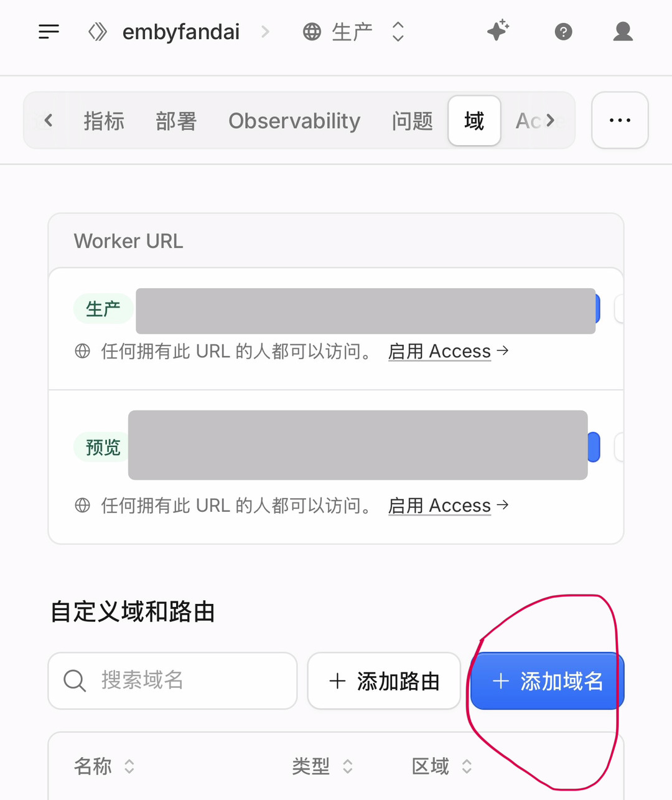

弹出的对话框里这样填：

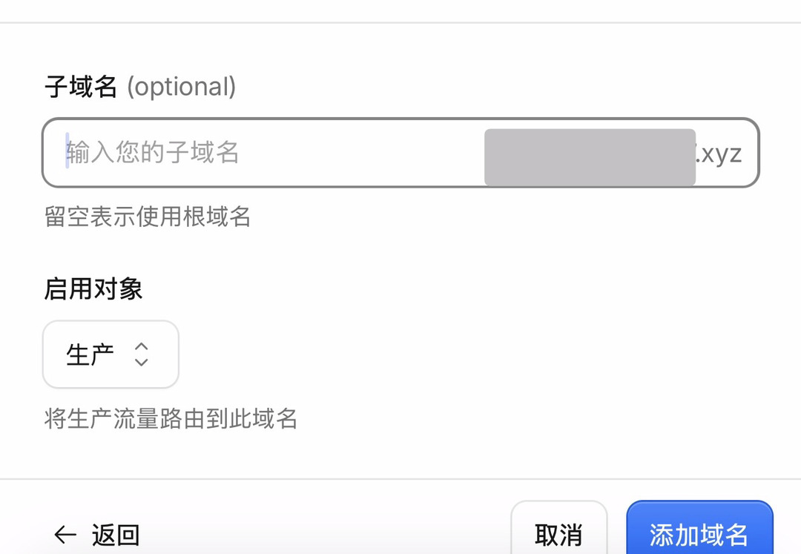

- **子域名**：填你想要的前缀，比如 `proxy`；
- 后面会自动补成 `proxy.1234.xyz`；
- **启用对象**：保持「生产」（将生产流量路由到此域名）；
- 点「添加域名」。

这一步把 `proxy.1234.xyz` 绑到了 Worker 上。

---

## 第二步：设置「回退源」

> ⚠️ 这步最容易被忽略，但不做的话第三步直接报红、加不了自定义主机名。

回到你在 Cloudflare 托管的**域名 A**（`1234.xyz`）面板：

左侧菜单 → **SSL/TLS** → **源服务器** → **自定义主机名**。

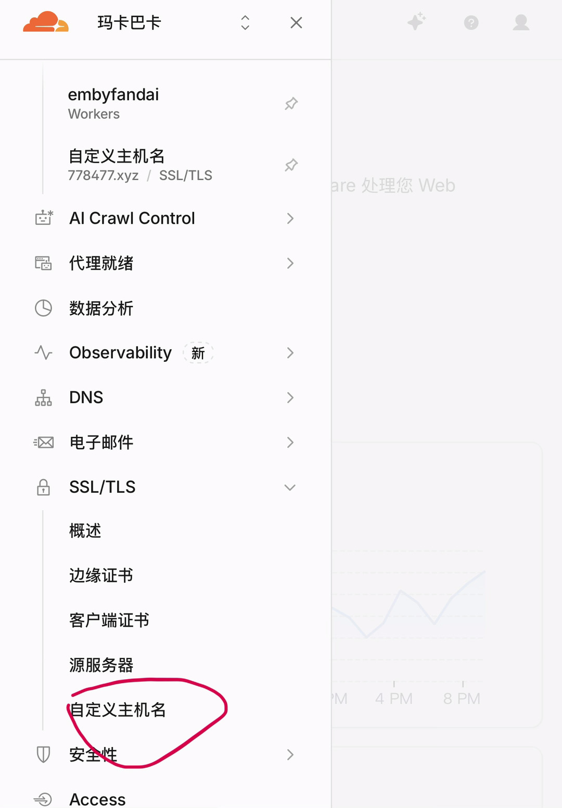

第一次进去会看到红色提示：「在添加新的自定义主机名之前，您必须设置回退源」。

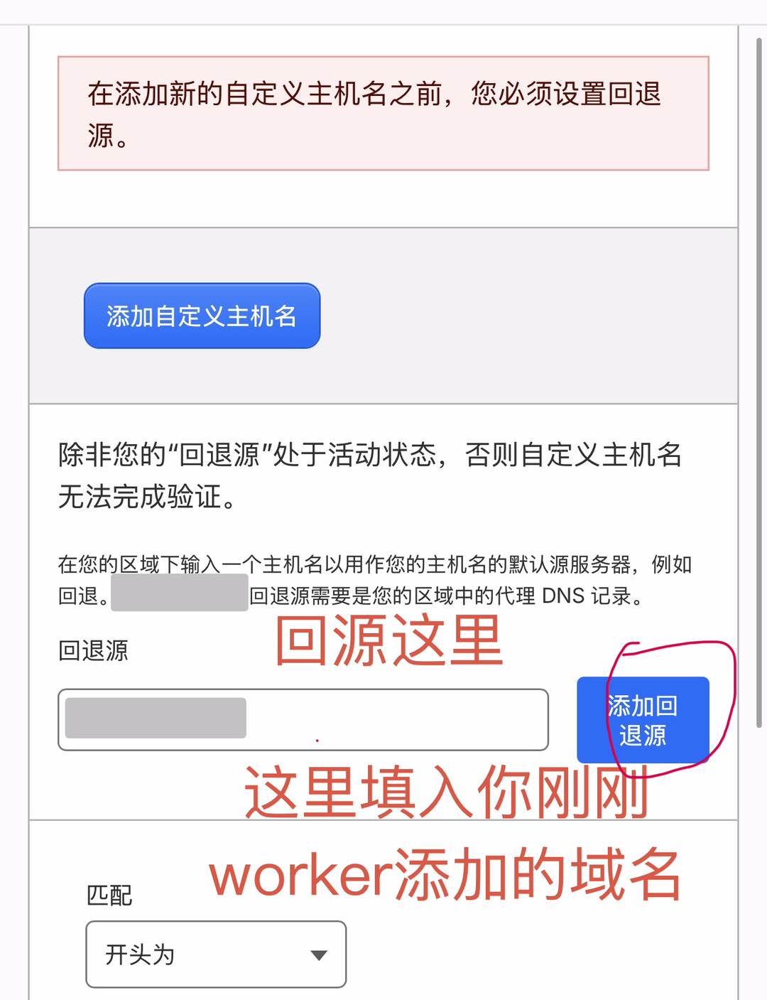

- 在「**回退源**」输入框里，填你**第一步刚绑到 Worker 的那个域名**（`proxy.1234.xyz`）；
- 它要求回退源必须是你区域里一条**已开启代理（橙色云）的 DNS 记录**——第一步绑完 Worker 后这条记录已经自动生成，直接填即可；
- 点「**添加回退源**」。

回退源状态变成绿色「**有效**」后，才能继续下一步。

---

## 第三步：添加自定义主机名（域名 B）

回退源好了之后，页面上的「**添加自定义主机名**」按钮才能点。

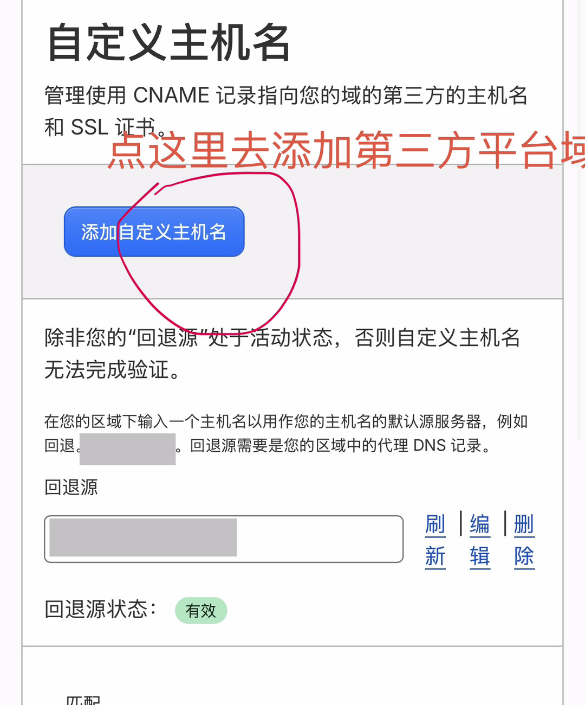

点它，按下面填：

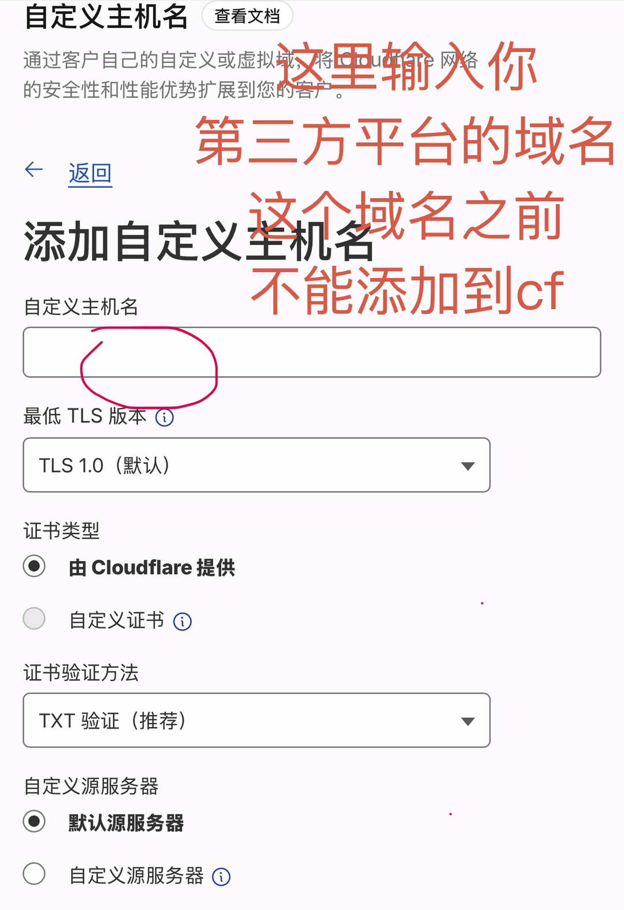

- **自定义主机名**：填你要加速的**第三方 SaaS 域名**（比如 `crush.example.com`）。
  - ⚠️ 这个域名**之前不能添加到过 Cloudflare**，不然会冲突。
- **最低 TLS 版本**：保持默认 `TLS 1.0` 即可。
- **证书类型**：选「**由 Cloudflare 提供**」。
- **证书验证方法**：选「**TXT 验证（推荐）**」。
- **自定义源服务器**：保持「默认源服务器」。

点确认提交。

---

## 第四步：去域名 B 的 DNS 加 TXT 验证记录

提交后，自定义主机名会出现在列表里，状态先是「初始化 / 待定」，并给出**两组 TXT 记录**让你去加。

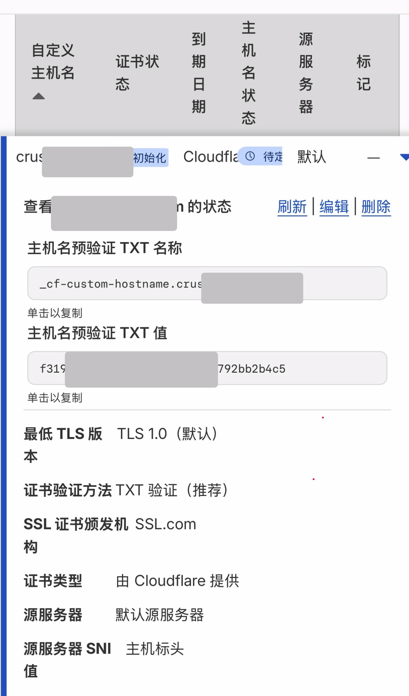

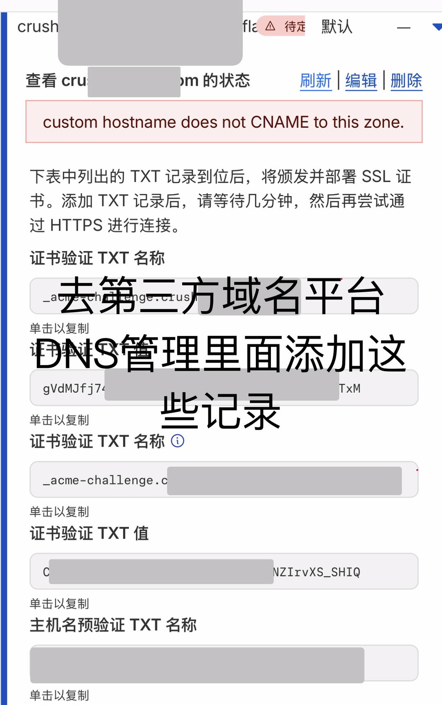

你会看到类似这些记录：

- **主机名预验证 TXT**
  - 名称：`_cf-custom-hostname.crush.example.com`
  - 值：一长串（照着复制）
- **证书验证 TXT**
  - 名称：`_acme-challenge.crush.example.com`
  - 值：一长串（照着复制）

**操作**：打开域名 B 的**第三方 DNS 管理后台**，把上面这两条 TXT 记录原样加进去。加完等几分钟（通常 1~5 分钟），回到 Cloudflare 这个页面点「刷新」。

> 过程中可能会出现一条红色提示 `custom hostname does not CNAME to this zone`——这是正常的，TXT 记录加到位、刷新生效后就会变绿。

---

## 第五步：验证通过

TXT 记录生效后，状态会变成：

- 证书状态：**有效**
- 主机名状态：**有效**
- 到期日期：自动签发（比如一两年后，到期会自动续）

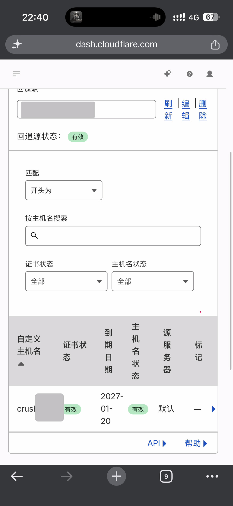

到这里，Cloudflare 已经开始用边缘节点给域名 B 提供 SSL 和 CDN 了。

---

## 第六步：Worker 加路由

回到 Worker →「域」→「自定义域和路由」→ 这次点「**添加路由**」（不是添加域名）。

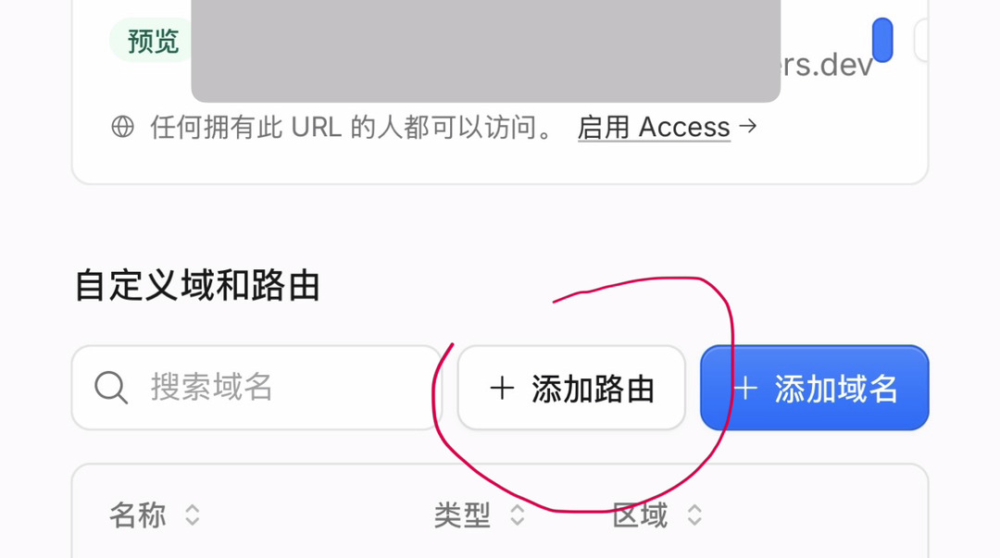

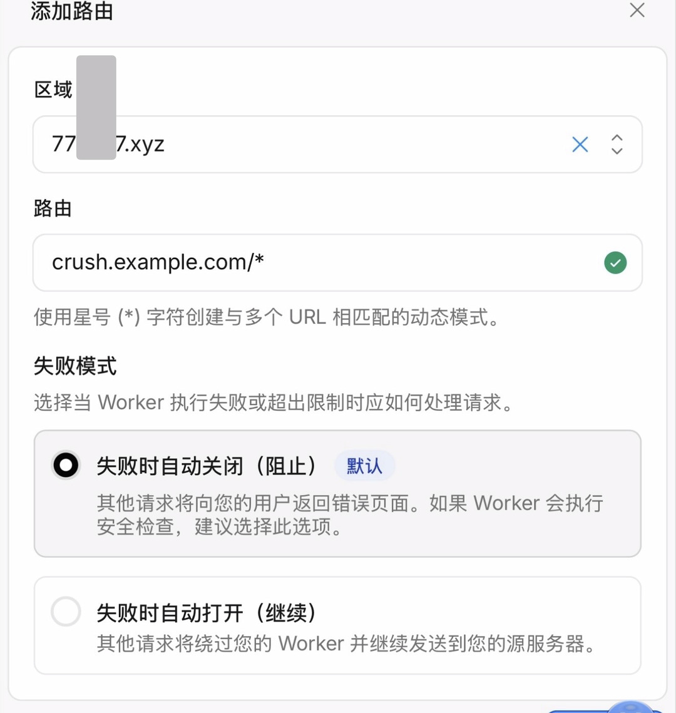

> 💡 这里别觉得奇怪：上面「**区域**」选的是你挂在 CF 的域名（`1234.xyz`），下面「**路由**」填的却是第三方域名 `crush.example.com`。两个域名看起来不是一家子，但这正是 SaaS 回源的玩法——把第三方域名的路由挂在你自己的 CF 区域下，它的请求才会进你的 Worker。

- **区域**：选你的域名 A 所在区域（`1234.xyz`）；
- **路由**：填 `crush.example.com/*`（用星号 `*` 匹配这个域名下所有路径）；
- **失败模式**：保持默认「失败时自动关闭（阻止）」。

保存。这样凡是访问域名 B 的请求，都会交给你的 Worker 处理。

---

## 第七步：域名 B 的 DNS 加一条 A 记录指向优选 IP

最后一步，回到域名 B 的**第三方 DNS 后台**，加一条 **A 记录**：

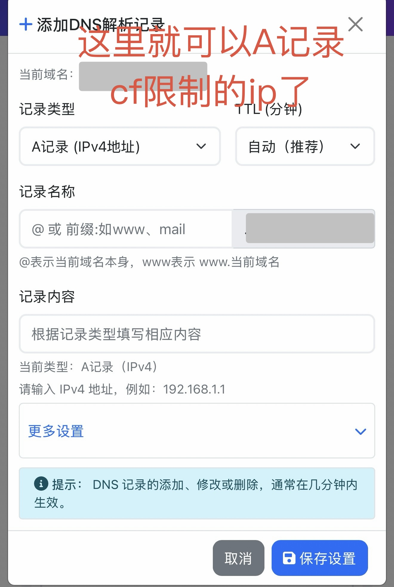

- **记录类型**：`A 记录（IPv4 地址）`；
- **记录名称**：填域名 B 的前缀（比如 `crush`）；
- **记录内容**：填你**优选出来的干净 Cloudflare IP**；
- **TTL**：自动（推荐）。

这一步就是让域名 B 解析到一个"跑得快"的 Cloudflare 边缘 IP，配合前面的 Worker 路由，实现你要的加速。

---

## 常见问题

**Q：回退源提示"不是有效代理 DNS 记录"？**
回退源必须是域名 A 区域里一条已经开了小橙云（代理）的 A/CNAME 记录。先确认第一步绑 Worker 后那条 `proxy.1234.xyz` 记录是橙色云代理状态。

**Q：自定义主机名一直"待定"？**
去检查域名 B 的 DNS 里 TXT 记录加对没有——名称和值要完全照抄，尤其是 `_cf-custom-hostname.` 和 `_acme-challenge.` 这两个前缀别漏。加对后点"刷新"，等几分钟。

**Q：提示 `custom hostname does not CNAME to this zone`？**
正常现象。你用的是 TXT 验证（域名 B 不在 CF 上，没法 CNAME），TXT 记录生效后这个提示会消失。

**Q：A 记录填什么 IP？**
填你用 CloudflareSpeedTest（cfst）跑出来的低延迟、高下载速度的 Cloudflare 优选 IP。

**Q：域名 B 以后想换优选 IP 怎么办？**
直接去第三方 DNS 后台改那条 A 记录的 IP 即可，不用动 Cloudflare 这边。
